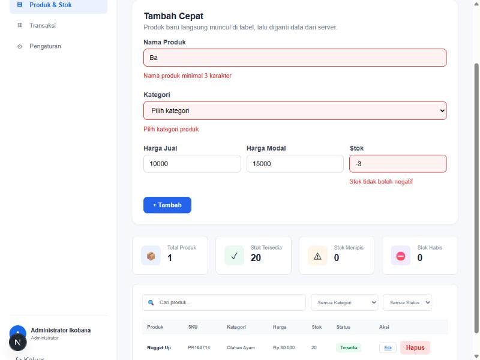

# Ikobana Frozen Food — Frontend

Aplikasi web (admin panel) untuk toko **Ikobana Frozen Food**, dibangun dengan Next.js 16 dan React 19.
Data diambil dari backend Spring Boot lewat REST API.

- **Backend:** https://github.com/hxjbruh/ikobana-backend
- **Desain Figma (PBL UAS):** [Desain PBL](https://www.figma.com/design/pEZ0bPbguRyatocuvTZjlr/Desain-PBL?node-id=1-2732&t=A5jZoRNV2Z0qw2Bt-1)
- Dokumentasi lengkap autentikasi & otorisasi (Tugas #9) ada di README backend.

## Menjalankan

Backend harus jalan dulu di `http://localhost:8080` (lihat README backend), lalu:

```bash
npm install
npm run dev
```

Buka http://localhost:3000. Alamat backend bisa diganti lewat `NEXT_PUBLIC_API_URL` di file `.env.local`.

## Akun Dummy

| Role | Email | Password |
|---|---|---|
| Admin | `admin@ikobana.com` | `Admin@12345` |
| Customer | `customer@ikobana.com` | `Customer@12345` |

## Autentikasi & Otorisasi di Frontend

- `app/lib/api.ts` — semua pemanggilan API, penyimpanan token JWT, dan guard `requireLogin(allowedRoles?)`
- Login (`/`) menyimpan token; setiap request mengirim `Authorization: Bearer <token>`
- **Keluar** memanggil `POST /api/auth/logout` (token di-blacklist di backend) lalu menghapus sesi di browser
- Token tidak valid / sudah logout (401) → otomatis kembali ke halaman login

| Halaman | Belum login | Customer | Admin |
|---|---|---|---|
| `/dashboard`, `/products`, `/transactions`, `/transactions/[id]` | ke login | ✅ (read-only) | ✅ |
| `/products/add`, `/products/edit/[id]`, `/settings` | ke login | ke `/forbidden` (403) | ✅ |
| Tombol tambah/edit/hapus produk, ubah status transaksi | — | disembunyikan | tampil |

Guard di UI hanya untuk tampilan; keamanan utama tetap di backend (Spring Security).

## Pertemuan 10 — Form, Validasi Schema & Mutasi Data (Lab CRUD)

CRUD produk sekarang lewat **Server Action** dengan schema validasi yang dipakai bersama oleh klien dan server.

| No | Langkah lab | Implementasi |
|---|---|---|
| 1 | Schema Zod bersama | `lib/schemas.ts` (`productSchema`), dipakai di form (klien) **dan** Server Action (server) |
| 2 | Action dengan error per field | `app/products/actions.ts`: `safeParse` di server, hasil ditampilkan lewat `useActionState` (`app/products/product-form.tsx`) |
| 3 | Update optimistik | Form **Tambah Cepat** di `/products`: `useOptimistic` menampilkan produk baru seketika, lalu diganti data dari server |
| 4 | Wrapper next-safe-action | `lib/safe-action.ts`: `authAction` (wajib login, token diverifikasi ke `GET /api/auth/me`) dan `adminAction` (khusus Admin) membungkus semua mutasi: tambah, ubah, hapus |

Alur:

```
Form → validasi klien (productSchema) → useOptimistic (baris sementara)
     → Server Action (adminAction)
         ├─ belum login / token tidak valid → ditolak
         ├─ bukan Admin                    → ditolak
         ├─ productSchema.safeParse gagal  → error per field
         └─ valid → simpan ke backend Spring
     → useActionState menampilkan error / sukses
```

Token login disimpan juga di cookie `ikobana_token` (selain `localStorage`) karena Server Action berjalan di server dan tidak bisa membaca `localStorage`.



### Hasil uji kriteria selesai (24 Oktober 2026)

| Kriteria | Cara uji | Hasil |
|---|---|---|
| Data tidak valid menampilkan error di bawah field yang tepat | Kirim form kosong / nama 2 huruf / stok negatif / harga jual < harga modal | ✅ Pesan muncul di bawah field masing-masing, nilai yang diketik tidak hilang |
| Server menolak data tidak valid walau validasi klien dilewati | `curl` langsung ke Server Action (lihat di bawah) dengan data salah | ✅ `validationErrors` per field (name, category, priceRetail, priceModal, stock) |
| Item baru muncul seketika, lalu diganti data dari server | Tambah Cepat di `/products` | ✅ Baris "Menyimpan…" (SKU belum ada) tampil dulu, ±0,25 detik kemudian diganti baris dari server (SKU asli) |
| Pengguna yang belum login ditolak oleh action | `curl` tanpa cookie, dengan token palsu, dan dengan token yang sudah logout | ✅ `serverError: "Anda harus login terlebih dahulu."` / `"Sesi tidak valid atau sudah berakhir..."` |
| (tambahan) Customer tidak boleh mengelola produk | `curl` dengan token Customer | ✅ `serverError: "Akses ditolak: hanya Admin..."` |

### Cara uji Server Action dengan curl

ID action bisa dilihat di `.next/dev/server/server-reference-manifest.json` (cari `createProductAction`) setelah halaman `/products` dibuka sekali di `npm run dev`.

```bash
# Tanpa login → ditolak
curl -X POST http://localhost:3000/products \
  -H "Next-Action: <ID_createProductAction>" \
  -H "Content-Type: text/plain;charset=UTF-8" \
  --data '[{"name":"Sosis","category":"OLAHAN_DAGING","priceRetail":"25000","priceModal":"18000","stock":"7"}]'

# Login sebagai Admin tapi data salah (validasi klien dilewati) → error per field
curl -X POST http://localhost:3000/products \
  -H "Next-Action: <ID_createProductAction>" \
  -H "Content-Type: text/plain;charset=UTF-8" \
  -H "Cookie: ikobana_token=<TOKEN_ADMIN>" \
  --data '[{"name":"A","category":"PIZZA","priceRetail":"-5","priceModal":"","stock":"1.5"}]'
```
